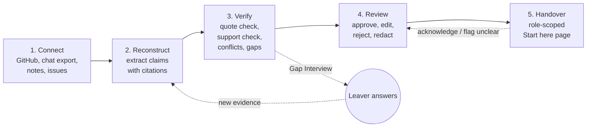
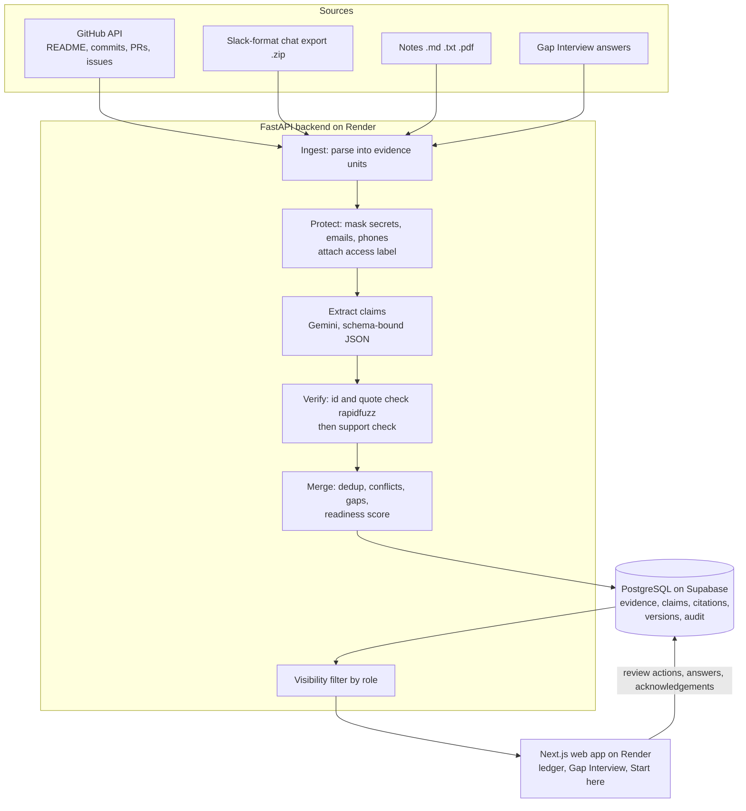
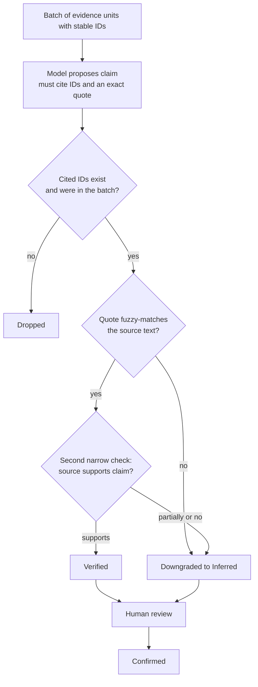
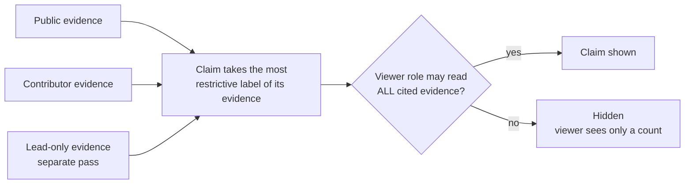
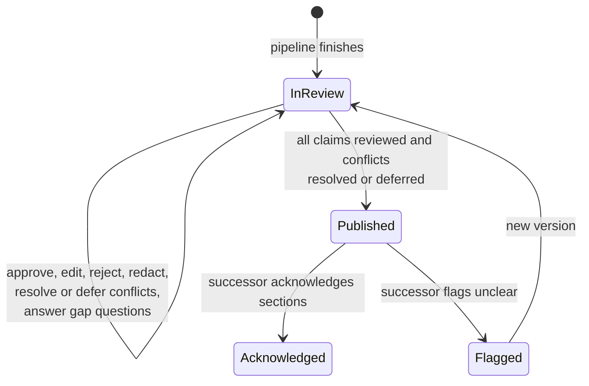

# Continuum

### Project handovers that show their work

**Live demo (no sign-in):** https://continuum-web-kodb.onrender.com &nbsp;·&nbsp; click **Enter as Reviewer**
Free hosting sleeps when idle, so the first load can take up to a minute.

Team **BINARY BUILDERS** · CodeFrontier (We Code Coders), Problem 01: *Prevent Critical Knowledge From Leaving With People*
**Pawan Singh Bhandari** (backend, AI/ML) · **Rahul Bramhankar** (frontend, design/UX)

---

## What it does

When someone leaves a project, most of what they know sits in scattered places: the repo, chat, notes and issues. Continuum rebuilds the project's current state from those sources and produces a handover in which **every statement links to its source** and carries an honest **evidence state**. It asks the leaver only the questions the evidence cannot answer. A reviewer approves exactly what the successor may see, and the successor can acknowledge each section or flag it as unclear.

Built for small software teams (student clubs, college projects, startups), where people rotate every semester.

## Four ideas that make it different

| Idea | What it means |
|---|---|
| **Claims, not summaries** | The handover is a list of atomic claims. Each has an evidence state and cited source text, so it can be checked line by line. |
| **Gap Interview** | The leaver answers only where evidence is missing or conflicting. Answers become new citable evidence ("Exit Q&A"). |
| **Permission before generation** | Every evidence unit has an access label. Lead-only text is processed in a separate pass, and a claim is shown only if the viewer may read *all* of its evidence. |
| **Handover as a loop** | Successor acknowledges or flags sections as unclear; flags are recorded for the reviewer and leaver. |

## Evidence states

| State | Meaning |
|---|---|
| **Verified** | A source states it and an automated check confirmed the source supports it. |
| **Inferred** | A reasonable conclusion not stated in any source. Labelled "AI inference, not stated in any source". |
| **Conflicting** | Sources disagree. Both are shown side by side and never auto-resolved. |
| **Missing** | A handover needs it but no evidence exists. Becomes a Gap Interview question. |
| **Confirmed** | A person approved or corrected it (who and when are recorded). |

## How it works



## Architecture



## How a claim earns "Verified"



## How permissions work



## Review and handover lifecycle



## What the successor receives

1. Project in five lines
2. Current state by workstream
3. Decision log with reasons
4. Your first week (ordered next actions)
5. Risks and landmines
6. Dependencies and people
7. Still unresolved (open questions and conflicts, stated honestly)

## Tech stack

| Layer | Choice |
|---|---|
| Frontend | Next.js 15 (TypeScript, App Router), Tailwind CSS v4, lucide-react |
| Backend | Python 3.11, FastAPI, Pydantic, httpx, rapidfuzz, pypdf. A small explicit pipeline, no agent framework |
| Database | PostgreSQL on Supabase (row-level-security policies in `supabase/migrations/0001_init.sql`) |
| AI | Google Gemini API (structured JSON output) behind a swappable provider interface (`api/app/llm.py`), with batching, retry, cache and model fallback |
| Hosting | Render (API and web), Supabase |
| Tests | pytest (27), Playwright (37 browser tests, axe accessibility), permission and diff unit tests, planted-facts scorer |

## Repository layout

```
api/                FastAPI backend and pipeline (Python)
web/                Next.js frontend (TypeScript)
supabase/migrations Database schema and row-level security
demo-data/          Synthetic "CampusKart" dataset (repo seed, chat export, notes) + answer key
docs/               Project PDF, testing, evaluation, user research, API contracts
```

## Run it locally

Copy `.env.example` to `.env` (api) and `.env.local` (web) and fill in values. Never commit keys.

```bash
# Web, mock mode (no keys needed)
cd web
npm install
npm run dev                 # http://localhost:3000
npm run test:unit           # permission, export, version-diff checks
npm run test:e2e            # Playwright, mock mode (uses installed Chrome)

# API
cd api
pip install -r requirements.txt
uvicorn app.main:app --reload
python -m pytest tests
```

The web app talks to the real API when `NEXT_PUBLIC_USE_MOCKS=false` (the deployed site) and to a built-in mock of the same contracts when it is `true`.
API: https://continuum-api-945j.onrender.com (`/health`). Deployed on Render from `render.yaml`; secrets are entered in the Render dashboard.

## Measured results (honest, single runs)

- Planted-facts test on the synthetic demo: **7 of 8** planted facts found; **94 of 94** shown claims carry a citation (`docs/evaluation.md`).
- Permission test: lead-only note, fake key and fake phone never appear in the Contributor or Leaver views; the 3 lead-only claims return HTTP 403 for them.
- Real-browser test of the full path on the deployed site (connect, conflicts, Gap Interview, approve, publish, Successor view, acknowledge, flag unclear) passes.
- User survey: 6 real responses. Details and limits in `docs/user-research.md`.

## Known limitations

- Roles are chosen in the UI and sent as a header. This is a demo, not a verified login. Row-level-security policies exist, but the demo relies on the API's role checks.
- Model output varies between runs. The UPI payments decision (PR #87) appears as Inferred rather than Verified. Fresh live runs can show false-looking conflicts that the reviewer must resolve or defer.
- Free hosting sleeps when idle; the free Gemini quota is small, so the demo handover replays a stored real run.
- Tested on the CampusKart demo only, not at scale.

## Documents

[Project PDF](docs/Continuum_Round2.pdf) · [Demo script](docs/demo-script.md) · [Testing](docs/testing.md) · [Evaluation](docs/evaluation.md) · [User research](docs/user-research.md) · [API contracts](docs/contracts.md) · [Manual testing report](docs/Rahul_Manual_Testing_Report.pdf) · [Frontend and testing work report](docs/RAHUL_WORK_REPORT.md) · [Project overview and build log](PROJECT_OVERVIEW.md)

## Disclosure (AI use, services, libraries)

- **AI assistance:** Claude (Anthropic) via Claude Code helped draft the Round 1 proposal and planning documents and assisted with coding during the build window. The team reviews all generated code and can explain it.
- **AI inside the product:** Google Gemini API (changed from the Round 1 plan, which named Claude) for claim extraction, support checks and contradiction checks. Outputs are schema-bound, checked by deterministic code (evidence id must exist, quote must match), and need human approval before publishing.
- **Services:** Supabase (PostgreSQL; Supabase Auth is not used yet), Render, GitHub REST API (read-only), Google Gemini API.
- **Libraries (each under its own open-source licence):** Web: Next.js, React, Tailwind CSS, lucide-react, Playwright. API: FastAPI, Uvicorn, Pydantic, httpx, rapidfuzz, pypdf, python-multipart, reportlab. shadcn/ui, PyGithub and detect-secrets from the Round 1 plan are not used.
- **Templates:** `web/` was scaffolded with `create-next-app@15`; everything else is written by us.
- **Data:** all demo data is synthetic. Any secrets or personal details in it are fake.
