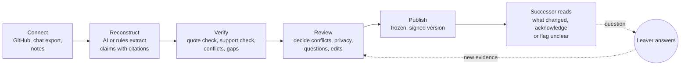
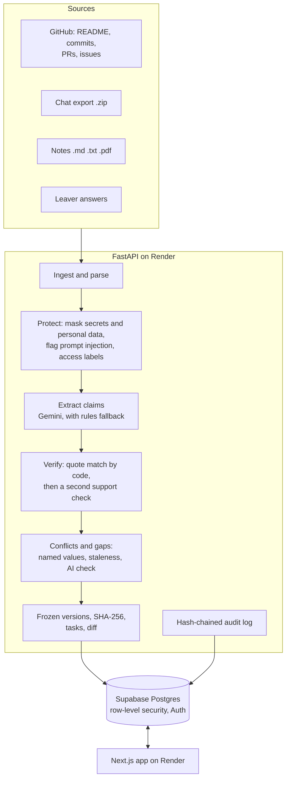
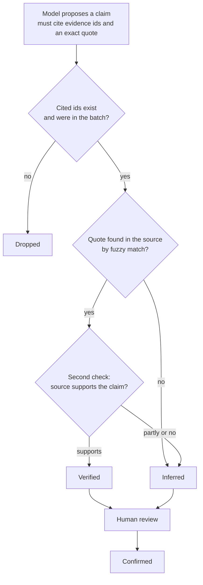
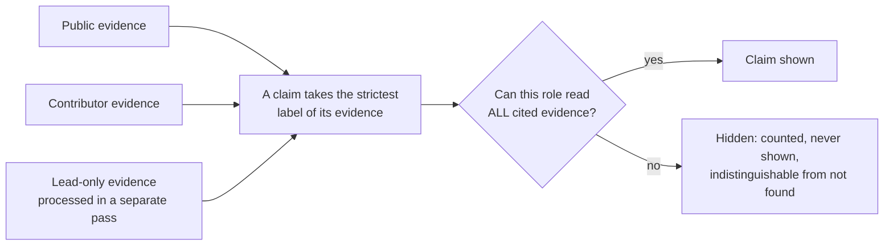

# Continuum

### Project handovers that show their work.

**Live product (no sign-in):** https://continuum-web-kodb.onrender.com · **Judge's tour (5 minutes):** https://continuum-web-kodb.onrender.com/tour
The first visit can take up to a minute while the free server wakes.

Team **BINARY BUILDERS** · CodeFrontier 2026, Problem 01: *Prevent Critical Knowledge From Leaving With People*
**Pawan Singh Bhandari** (backend, AI, security) · **Rahul Bramhankar** (frontend, design, usability testing)

---

## What it does

When someone leaves a project, their knowledge sits in the repo, chat, notes and issues. Continuum rebuilds the project's current state from those sources and produces a handover in which **every statement cites its source and carries an honest evidence state**. It asks the leaver only what the evidence cannot answer. A reviewer settles disagreements and approves exactly what the successor may see. The successor reads a **signed, frozen version**, acknowledges it or flags what is unclear, and sees precisely what changed in each new version.

Built for small software teams (3 to 25 people), such as student clubs and college projects where people rotate every semester.

## Try it in 5 minutes

Open the [Judge's tour](https://continuum-web-kodb.onrender.com/tour). Each step switches role for you and opens the right screen of **your own copy** of the demo project (nothing you do affects other visitors).

| Step | You are | You do | You see |
|---|---|---|---|
| 1 | Reviewer | Conflicts: keep the Vercel side, write who confirmed it | One disagreement, both sources with dates, a decision history |
| 2 | Reviewer | Privacy: review what was masked | UPI ID, PAN and Aadhaar masked; a remark about a teammate waits for your decision |
| 3 | Reviewer | Questions: use the leaver's answer, then publish v2 | A new signed version |
| 4 | Successor | Start here | "What changed since you last read", only changed sections ask to be acknowledged again |
| 5 | Leaver | Gap Interview | Answers become citable evidence; keys and passwords are refused |
| 6 | Reviewer / Guest | Activity, then "Verify integrity"; enter as Guest | A tamper-evident log of every decision, view and export; the public-only view |

## The three improvements we committed to, and what shipped

| Committed to in Round 2 | Delivered | Where to see it |
|---|---|---|
| **1. Cross-source conflict resolution** | Conflicts are found across README, commits, chat and notes by comparing named values (and an AI check for the rest), with "documentation older than the code" detection. One disagreement is one card with every side, its source, author, date and quote. Five decisions (keep a side, both true, correct it, defer, reopen), each with a required reason and a full history. | Conflicts tab |
| **2. Acknowledgement loop and version diff** | Published versions are frozen with a SHA-256 fingerprint. "This is unclear" becomes a question to the leaver and reviewer; the answer becomes evidence; the reviewer attaches it and publishes the next version. The successor sees what changed (added, changed, removed, with before and after text) and re-acknowledges only changed sections. | Start here, Questions, Gap Interview |
| **3. Sensitive-data protection** | Detectors for keys, tokens, UPI IDs, PAN, Aadhaar (checksum-validated), IFSC and phone numbers; a privacy review queue where raw values never leave the server; remarks about people wait for a reviewer decision; Guest role; an audit log of views, approvals and exports where each entry fingerprints the previous one (with a Verify button); signed Markdown exports with a public Verify page; real email sign-in with database-enforced access. | Privacy, Activity, Sign in, Verify |

Also new since Round 2: it **works without AI** (a rules mode finds all 8 planted facts on its own, and takes over automatically if the AI is unavailable), every visitor gets their own demo copy, prompt-injection protection, and fixes for the Round 2 rough edges (duplicate conflicts, wrong dates, version counting, hidden items now indistinguishable from missing ones).

## Evidence states

| State | Meaning |
|---|---|
| **Verified** | A source states it and an automated check confirmed the source supports it. |
| **Inferred** | A reasonable conclusion not stated in any source; labelled "AI inference, not stated in any source". |
| **Conflicting** | Sources disagree. Every side is shown; never auto-resolved; the newest is not assumed correct. |
| **Missing** | A handover needs it but no evidence exists. Becomes a Gap Interview question. |
| **Confirmed** | A person approved or corrected it (who and when are recorded). |

## How it works









## Tech stack

| Layer | Choice |
|---|---|
| Web | Next.js 15 (TypeScript, App Router), Tailwind CSS v4, lucide-react |
| API | Python 3.11, FastAPI, Pydantic, httpx, rapidfuzz, pypdf. A small explicit pipeline, no agent framework |
| Data and auth | Supabase: PostgreSQL with row-level security, Supabase Auth (email link, no passwords) |
| AI | Google Gemini (structured JSON output) behind a swappable interface, with an automatic rule-based fallback |
| Hosting and CI | Render (API and web), GitHub Actions |

## Measured results (all reproducible; dates in `docs/evaluation.md`)

| Check | Result |
|---|---|
| Planted facts found, AI mode / no-AI rules mode | 8 of 8 / 8 of 8 |
| Privacy and injection checks on planted items | 4 of 4 in both modes |
| Claims with a valid, checked citation | 114 of 114 (AI mode), 29 of 29 (rules mode) |
| API tests (in-memory store, no keys) | 57 passing |
| Live API end-to-end, three improvements and leak sweep | 19 of 19 |
| Browser judge path on the live site | 15 of 15 |
| Database row-level-security check (reads tables directly, bypassing the app) | 13 of 13 |
| Accessibility (axe, serious and critical) on every screen per role; phone width 375 px | pass |

## Run it yourself

```bash
# API: everything in memory, CampusKart preloaded, no database, no AI key, no network
cd api && pip install -r requirements.txt && python dev.py        # http://localhost:8000
# Web
cd web && npm install && NEXT_PUBLIC_API_URL=http://localhost:8000 npm run dev   # http://localhost:3000
# Tests
cd api && python -m pytest tests -q
CONTINUUM_GITHUB=snapshot python evaluate.py --offline-rules      # planted facts without any AI
cd web && npm run test:e2e                                         # browser tests (see playwright.config.ts)
```

Copy `.env.example` to `api/.env` for the real database and Gemini. Never commit keys. Deployment: `render.yaml`.

## Repository layout

```
api/                FastAPI backend, pipeline, rules mode, tests, live and database check scripts
web/                Next.js app and browser tests
supabase/migrations Schema, row-level security, accounts and membership
demo-data/          Synthetic "CampusKart" dataset: chat export, notes, stored run, GitHub snapshot, answer key
docs/               Project document, evaluation, testing, user research, API contracts, Round 3 design notes
```

## Documents

[Final product document (PDF)](docs/Continuum_Round3.pdf) · [Evaluation and measurements](docs/evaluation.md) · [Testing](docs/testing.md) · [User research](docs/user-research.md) · [API contracts](docs/contracts.md) · [Project overview and build log](PROJECT_OVERVIEW.md)

## Disclosure (AI use, services, libraries)

- **AI assistance:** Claude (Anthropic) via Claude Code assisted with planning and coding during the build windows. The team reviews all generated code and can explain it.
- **AI inside the product:** Google Gemini for claim extraction, support checks and contradiction checks, always behind deterministic checks (evidence ids must exist, quotes must be found in the source), and a rule-based mode that needs no AI.
- **Services:** Supabase (PostgreSQL, Auth), Render, GitHub REST API (read-only), Google Gemini API.
- **Libraries (each under its own open-source licence):** Web: Next.js, React, Tailwind CSS, lucide-react, Playwright, axe-core. API: FastAPI, Uvicorn, Pydantic, httpx, rapidfuzz, pypdf, python-multipart.
- **Templates:** `web/` was scaffolded with `create-next-app@15`; everything else is written by us.
- **Data:** all demo data is synthetic. Every key, ID number and phone number in it is fake.
